## Who am I?

Hi, I'm **Abolfazl Sadri**, a frontend developer from Iran. I've been building for the web for about three years, and I'm focused on React and Next.js. I like turning ideas into clean, responsive and modern interfaces, and I share what I learn through daily posts on [LinkedIn](https://www.linkedin.com/in/abolfazl-sadri).

## What I do

- Build responsive, modern UIs with React, Next.js and Tailwind CSS
- Build full-stack features with Supabase, Auth.js and Stripe
- Practice on real-world projects and clones to sharpen my skills
- Share frontend tips, tutorials and news every day on LinkedIn

## Tech stack

  

## Featured projects

| Project | Description |
| --- | --- |
| [the-wild-oasis-website](https://github.com/abolfazllsadri/the-wild-oasis-website) | Luxury cabin booking website built with Next.js 16, React 19, TypeScript, Tailwind CSS 4, Supabase, Auth.js and Stripe Checkout |
| [the-wild-oasis](https://github.com/abolfazllsadri/the-wild-oasis) | Hotel management dashboard for staff, built with React |
| [linkedin-clone](https://github.com/abolfazllsadri/linkedin-clone) | LinkedIn clone built with Next.js |
| [facebook-clone](https://github.com/abolfazllsadri/facebook-clone) | Facebook clone built with Next.js |
| [todo-list](https://github.com/abolfazllsadri/todo-list) | My first full JavaScript project |

## Currently learning

- Advanced TypeScript patterns
- Advanced Next.js (rendering strategies, caching, performance)
- Advanced Tailwind CSS techniques

## Open to work

Open to full-time, part-time, remote and freelance frontend opportunities.

## Let's connect

